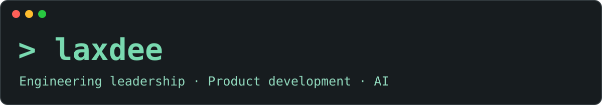

# Deepak · LaxDee

**20 years in industry. Building my own ventures.**

I'm an engineering leader focused on AI-assisted product development—from shaping requirements and working with coding agents to reviewing what gets built.

## Building now

| Venture | What it's about |
| :--- | :--- |
| **[PrintMe3D ↗](https://printme3d.in)** | 3D-printed products and custom production |
| **[SomRatri ↗](https://somratri.com)** | Curated overnight gatherings |

*Both are commercial ventures with private codebases.*

## Engineering focus

~~~yaml
product: Rails applications · Commerce · Booking systems
ai: Coding-agent workflows · Reusable agent skills
operations: Integrations · Self-hosted infrastructure
~~~

## The journey

Before starting my own ventures, I spent **nine years working on [ProcurementExpress](https://procurementexpress.com)**.

My background includes **20 years of industry experience** and a **master's degree**. Today, my focus brings together engineering leadership, product development and practical applications of AI.

## Next: sharing more

I plan to share useful tools and projects with the community. I'll feature them here as they become available.

---

**[Explore laxdee.com →](https://laxdee.com)** · **[PrintMe3D](https://printme3d.in)** · **[SomRatri](https://somratri.com)**
